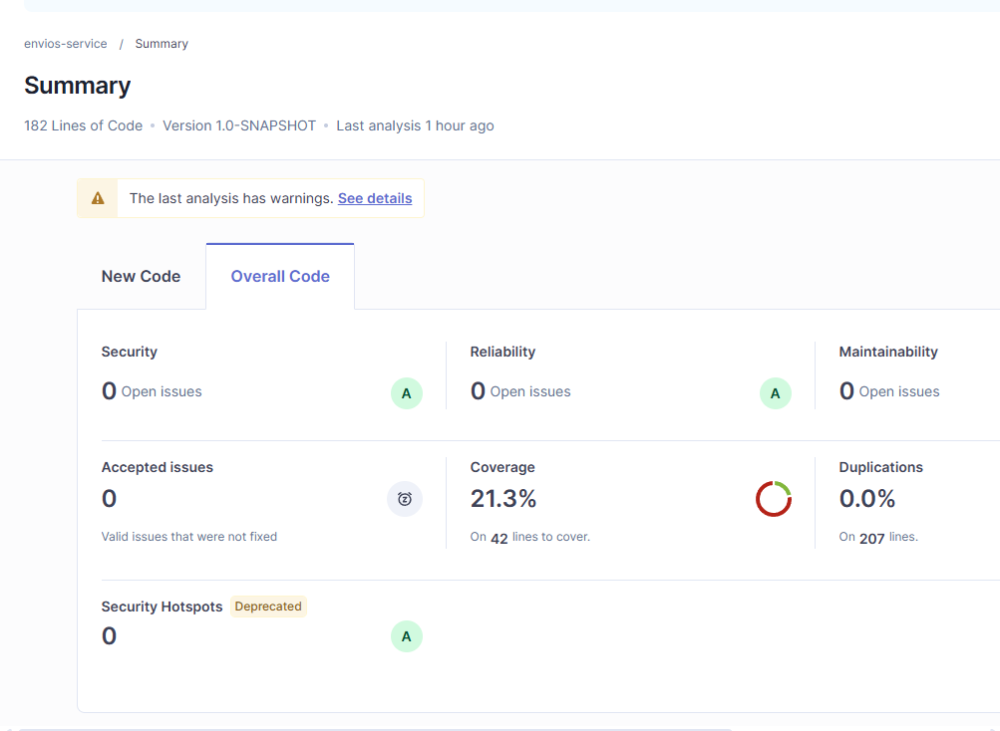
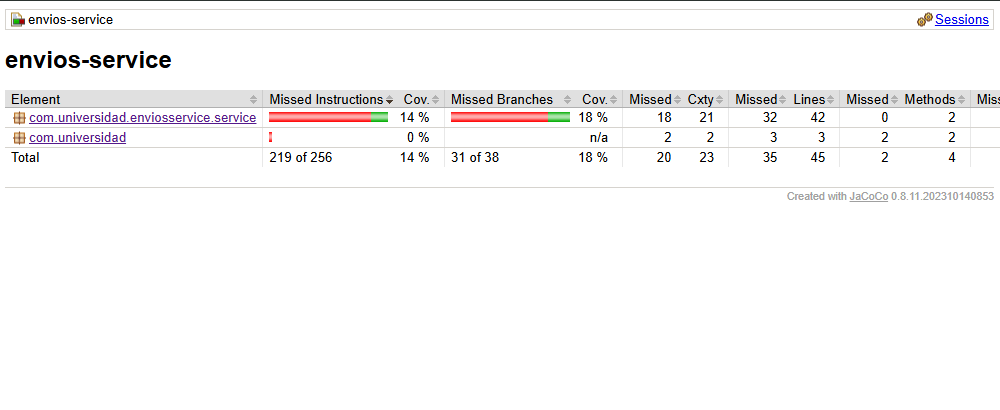
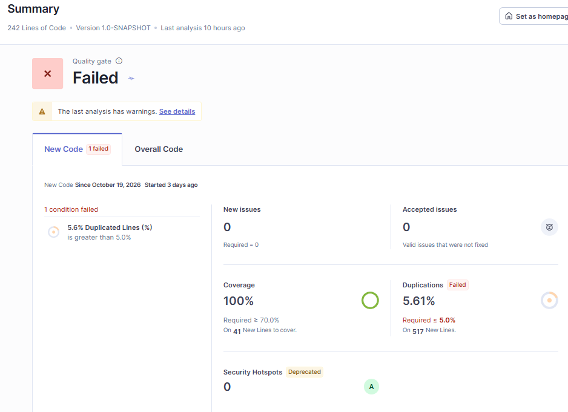
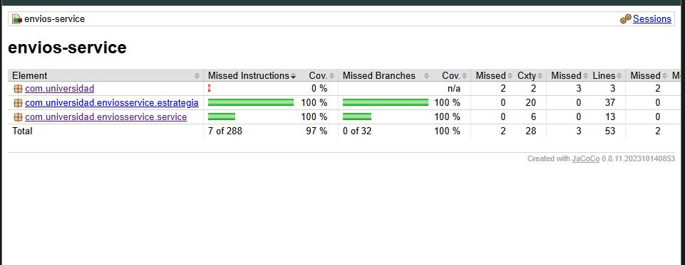

## Entorno de análisis

## Estado inicial del análisis
| Métrica | Valor real observado |
|---------|----------------------|
| Complejidad ciclomática de calcularCosto() | 20 |
| Cobertura de líneas de ServicioCalculoEnvio | 23.8% |
| Cobertura de ramas de ServicioCalculoEnvio | 18.4% |
| Code Smells reportados | 0 |

## Interpretación
En la sección Measures → Complexity se evidencia que el método calcularCosto() de la clase ServicioCalculoEnvio presenta una complejidad ciclomática de 20, la más alta del proyecto. Esta misma clase registra una cobertura de líneas del 23,8 % (10/42) y una cobertura de ramas del 18,4 % (7/38). Ambos resultados reflejan aspectos distintos del método: mientras la complejidad ciclomática evidencia la cantidad de caminos independientes de ejecución, la cobertura muestra que las pruebas actuales ejercitan una proporción reducida de las ramas disponibles. Aunque ambas métricas están relacionadas, pues una complejidad ciclomática alta implica más caminos independientes que considerar al diseñar las pruebas, no implica necesariamente una cobertura baja, ya que esta también depende de las pruebas diseñadas y ejecutadas.

La métrica utilizada como señal principal fue la complejidad ciclomática, pues permite valorar la complejidad del comportamiento del método a partir de sus caminos independientes de ejecución, los cuales deben considerarse al verificar sus resultados. En este caso, su valor de 20, junto con la baja cobertura de ramas, refuerza la decisión de priorizarlo para una intervención. La cobertura, sin embargo, refleja principalmente cuánto se ha ejercitado mediante las pruebas y no permite determinar por sí sola si el diseño del método es deficiente. Por su parte, aunque la complejidad cognitiva también permite identificar dificultades que podrían justificar una intervención, se centra en la dificultad de comprender el código, mientras que la complejidad ciclomática aporta un criterio más directamente relacionado con los caminos de ejecución que deben verificarse. Por ello, se selecciona esta última como señal principal, sin descartar las demás métricas como información complementaria.

# Envios Service — Diagnóstico y Mejora Guiada por Métricas

## Decisiones de diseño
1. Entorno de análisis: Se selecciona Docker local por ser el proyecto lo suficientemente pequeño o poco exigente como para que resulte razonable analizarlo localmente, ademas de la mayor libertad que supone no estar bajo el servicio gratuito de SonarCloud.
   
2. Exclusiones del análisis: Se excluye la clase App.java por no contener logica que se quiera cubrir, para evitar que su presencia distorsione las metrica de cobertura.
   
3. Métrica usada como señal principal: La métrica utilizada como señal principal fue la complejidad ciclomática, pues permite valorar la complejidad del comportamiento del método a partir de sus caminos independientes de ejecución, los cuales deben considerarse al verificar sus resultados. En este caso, su valor de 20, junto con la baja cobertura de ramas, refuerza la decisión de priorizarlo para una intervención. La cobertura, sin embargo, refleja principalmente cuánto se ha ejercitado mediante las pruebas y no permite determinar por sí sola si el diseño del método es deficiente. Por su parte, aunque la complejidad cognitiva también permite identificar dificultades que podrían justificar una intervención, se centra en la dificultad de comprender el código, mientras que la complejidad ciclomática aporta un criterio más directamente relacionado con los caminos de ejecución que deben verificarse. Por ello, se selecciona esta última como señal principal, sin descartar las demás métricas como información complementaria.
   
4. Patrón elegido: Se selecciona el patrón Strategy para refactorizar el método calcularCosto() de la clase ServicioCalculoEnvio, debido a que las ramas asociadas a metodoEnvio representan algoritmos alternativos de cálculo tarifario. Las modalidades ESTANDAR, EXPRESS, OVERNIGHT e INTERNACIONAL emplean fórmulas propias, seleccionadas mediante un valor de entrada, y producen el mismo tipo de resultado. Strategy permite encapsular estos algoritmos en implementaciones independientes e intercambiables, evitando concentrar su selección y sus cálculos en una única estructura condicional.

Se descarta State porque el comportamiento no depende de un estado interno que persista entre llamadas ni de transiciones entre estados: cada cálculo depende de los argumentos recibidos. También se descarta Chain of Responsibility, porque las modalidades de envío son alternativas mutuamente excluyentes y no existe una secuencia de responsables que deba evaluarse hasta que alguno resuelva la solicitud.

5. Criterio de pruebas agregadas: El reporte inicial de JaCoCo mostró una cobertura de instrucciones del 14 % y una cobertura de ramas del 18 % para ServicioCalculoEnvio, con 32 de sus 42 líneas sin cubrir. El código concentraba el cálculo de cuatro modalidades de envío, sus tramos de peso, recargos por distancia, restricciones y ajustes según las características del envío y el cliente. Por tanto, la estrategia de pruebas debía cubrir comportamientos distintos, en lugar de limitarse a aumentar la cantidad de casos ejecutados.

Se identificaron las siguientes condiciones sin cubrir en el reporte inicial:

Modalidad y peso: las condiciones de selección de envío estándar, express, overnight e internacional presentaban ramas sin cubrir. También estaban sin cubrir los tramos de peso superiores a 5 kg y, según la modalidad, superiores a 20 kg. Se incorporaron pruebas específicas para cada estrategia, con pesos de 3, 8 y 25 kg, que ejercitan los tramos de hasta 5 kg, entre 5 y 20 kg y superiores a 20 kg.

Recargos por distancia: en el envío estándar, la condición distanciaKm > 500 no tenía ambas ramas cubiertas. Se añadieron casos con 500 y 501 km para comprobar tanto la ausencia como la aplicación del recargo. Se aplicó el mismo criterio al envío express, cuyo límite también es de 500 km, y al internacional, cuyo límite es de 5000 km, mediante casos en el límite y por encima de él.

Restricción de overnight: la condición distanciaKm > 300 no estaba cubierta. Se incorporaron pruebas para verificar el cálculo de esta modalidad y el lanzamiento de IllegalArgumentException cuando la distancia supera los 300 km.

Fragilidad y categoría del cliente: la condición esFragil tenía una rama sin cubrir, al igual que la alternativa corporativa del descuento por tipo de cliente. Se añadieron pruebas que verifican el recargo del 15 % por fragilidad, los descuentos del 10 % para clientes premium y del 15 % para clientes corporativos, así como la combinación de fragilidad y descuento corporativo.

Métodos no soportados: se incorporó una prueba que verifica que una modalidad desconocida provoca IllegalArgumentException y comprueba el mensaje de error esperado.

Esta ampliación acompañó la aplicación del patrón Strategy, que separó los algoritmos de cálculo en EnvioEstandarStrategy, EnvioExpressStrategy, EnvioOvernightStrategy y EnvioInternacionalStrategy. Las pruebas se distribuyeron entre estas estrategias y el servicio que aplica los ajustes comunes, con aserciones sobre los resultados calculados y las excepciones esperadas.

En el reporte posterior de JaCoCo, los paquetes estrategia y service alcanzaron el 100 % de cobertura de ramas, mientras que el proyecto completo llegó al 97 % de cobertura de instrucciones. Estos resultados evidencian una mejora en la ejecución de las condiciones de la lógica de negocio. No obstante, la cobertura no demuestra por sí sola la corrección funcional del sistema: también es necesario verificar que las aserciones detecten resultados incorrectos y que los casos de prueba representen los límites y comportamientos relevantes.

6. Realismo del Quality Gate: Se seleccionó CC ≤ 10, considerado como el límite superior del rango «Moderado» en la tabla 3.2 de esta guía. Se selecciona porque permite mantener un criterio exigente sin obligar a descomponer todos los métodos que alcanzan ese valor, siempre que continúen siendo comprensibles y mantenibles. Además, coincide con el límite de referencia utilizado por herramientas de análisis como SonarQube en determinadas reglas de complejidad. Este umbral no implica que todo método con CC = 10 sea necesariamente adecuado, sino que los métodos que lo superen deberán revisarse para determinar si conviene refactorizarlos.

Por otro lado, se selecciona 70% de cobertura mínima como un compromiso entre una cobertura significativa y la viabilidad de las pruebas. Exigir el 100 % podría incentivar la creación de pruebas triviales que aumenten la métrica sin verificar correctamente el comportamiento del sistema, problema señalado en la Sección 2.3. El 70 % establece un mínimo verificable sin asumir que cada línea ejecutable necesita necesariamente una prueba independiente. Cuando sea posible, el código de infraestructura, las clases de configuración y los DTO simples deben excluirse del cálculo para que la métrica represente mejor la cobertura de la lógica relevante.

## Comparación antes / después
| Métrica | Antes (Parte 1) | Después (Parte 2) |
|---------|------------------|--------------------|
| Complejidad ciclomática de calcularCosto() | 20 | 5 |
| Cobertura de ramas de la lógica de envío | 23.8% | 100% |
| Code Smells | 0 | 0 |
| Quality Gate | — | Failed |

### Análisis del Quality Gate failed en parte 2
El análisis de SonarQube muestra que el Quality Gate «Estándar Laboratorio» no se cumple, debido a la condición que establece un máximo del 5 % de código duplicado. El análisis reporta un 5.6% de líneas duplicadas en el código introducido, superando el límite establecido. Esta duplicación se relaciona principalmente con dos de las nuevas clases Strategy: EnvioEstandarStrategy.java y EnvioExpressStrategy.java, en las cuales SonarQube identifica respectivamente un 63,2 % y un 60,7 % de líneas duplicadas.

La duplicación identificada no corresponde necesariamente a un error de diseño. Al revisar ambas clases, se observa que comparten una estructura de cálculo muy similar: ambas dividen el peso en los mismos tres rangos, calculan el costo a partir de la distancia, aplican un recargo cuando esta supera los 500 km y posteriormente aplican sus respectivas tarifas. Las diferencias se encuentran principalmente en los valores utilizados para cada operación. Por ello, la duplicación puede considerarse estructural, ya que surge de la similitud natural entre dos estrategias que implementan algoritmos relacionados, y no necesariamente de una copia accidental.

Aunque SonarQube señala esta duplicación como un problema de mantenibilidad y provoca el incumplimiento del Quality Gate, esto no implica que deba realizarse una refactorización de manera automática. Se debe evaluar el costo y beneficio de extraer la lógica común, considerando si la reducción de duplicación compensa el aumento de acoplamiento o complejidad que podría introducirse entre las estrategias. En consecuencia, el incumplimiento se documenta como una condición pendiente de evaluación, priorizando la mantenibilidad y el diseño del sistema por encima del cumplimiento aislado de una métrica.

## Capturas

## Herramientas utilizadas
- Java 21, Apache Maven
- SonarQube Community Edition o SonarCloud, JaCoCo, Docker 
- Git, GitHub

## Conclusiones
En este postcontenido se profundizó en el uso de JaCoCo, SonarQube y Docker mediante su aplicación en un escenario práctico, lo que permitió comprender cómo se complementan en el análisis de cobertura, calidad y ejecución del software. Asimismo, se desarrolló la capacidad de interpretar las métricas obtenidas y relacionarlas con el estado del proyecto. Finalmente, se fortaleció el criterio técnico para tomar decisiones de mejora fundamentadas, reconociendo que las métricas de las herramientas deben analizarse en su contexto y no asumirse como indicadores absolutos de calidad.
